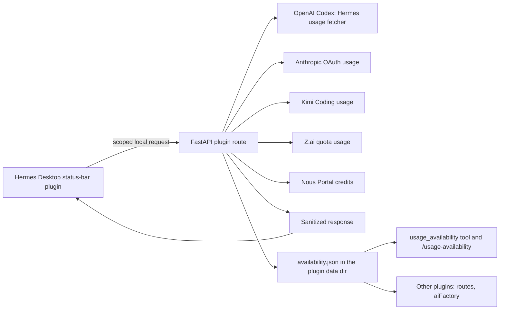

# Architecture

## Components



## Desktop frontend

`desktop/plugin.js` is a build-free Hermes Desktop plugin. It:

- Reads the focused session and runtime model from Hermes SDK state/events.
- Maps the runtime to a supported usage provider.
- Calls only its scoped backend through `ctx.rest('/usage')`.
- Keys every cache entry, query and alert memory by profile and connection, and drops a response that
  arrives after the active profile or route changed (`gatewayActivationEpoch`). When two sources expose the same
  profile name nothing is persisted, and the in-memory alert state is also keyed by that epoch, so one source's
  alert levels never carry over to the other. The flip side is deliberate: a source that is still critical is
  announced again once per activation (documented in USER_GUIDE.md and PRIVACY.md).
- Keeps manual status-bar selection in plugin-local storage.
- Merges a temporarily unavailable provider with its last valid card and marks it stale.
- Shows a toast and a native notification when a window crosses the configured thresholds.
- Keeps model-capped windows (Opus / Sonnet weekly) out of the status bar unless the session runs that model.
- Picks the chip's window with the same policy as `availability.json` (exhausted first, the one that blocks longest;
  otherwise the lowest of session and week) and marks an exhausted window in the chip.

## Python backend

`dashboard/plugin_api.py` mounts `/api/plugins/usage-dashboard/usage`. It:

- Reads Codex through `agent.account_usage.fetch_account_usage("openai-codex", read_only=True)`, so the
  plugin never holds the ChatGPT sign-in.
- Reads Kimi and Z.ai keys with `agent.secret_scope.get_secret`, which honours the active profile.
- Queries providers concurrently with bounded HTTP timeouts.
- Normalizes percentages and reset times.
- Returns a fixed, sanitized card schema.
- Uses a process cache and collection lock to avoid request storms (launch profile only).
- Never binds a secret scope itself: Hermes 0.22+ binds one on every plugin route. A request without a scope
  gets `missing_profile_scope` cards.
- Writes `availability.json` after every collection.

`__init__.py` registers the `usage_availability` tool and the `/usage-availability` command. They read
`availability.json` (through `availability.py`) and never call a provider.

## Sanitized response contract

```json
{
  "fetched_at": "ISO-8601 timestamp",
  "providers": [
    {
      "provider": "provider-id",
      "label": "Display name",
      "available": true,
      "plan": "Optional plan label",
      "source": "sanitized source name",
      "fetched_at": "ISO-8601 timestamp",
      "stale": false,
      "windows": [
        {
          "label": "Window label",
          "used_percent": 25.0,
          "remaining_percent": 75.0,
          "reset_at": "ISO-8601 timestamp or null",
          "detail": "Optional sanitized detail",
          "scope": "account"
        }
      ],
      "details": [],
      "reason": null
    }
  ],
  "summary": {
    "available": 1,
    "total": 5,
    "lowest_remaining_percent": 75.0
  },
  "settings": { "alerts_enabled": true, "alert_warn_percent": 80, "alert_critical_percent": 95 },
  "privacy": "Credentials remain in the local backend."
}
```

`scope` is `account` or `model`. A `model` window caps one model family and never counts toward
`lowest_remaining_percent`. The contract excludes tokens, headers, raw responses, email addresses, account
identifiers, and OAuth claims.

## `availability.json` (published for other plugins)

Written atomically to `plugin_data_dir("usage-dashboard")/availability.json` on every collection:

```json
{"schema": 1, "generated_at": "2026-11-06T07:52:04Z",
 "providers": {
   "anthropic":    {"state": "ok", "remaining_percent": 77, "window": "session", "reset_at": "2026-11-06T11:50:00Z", "stale": false},
   "openai-codex": {"state": "exhausted", "remaining_percent": 0, "window": "session", "reset_at": "2026-11-06T11:21:00Z", "stale": false},
   "zai":          {"state": "unknown", "remaining_percent": null, "window": null, "reset_at": null, "stale": true}}}
```

- Keys are Hermes provider ids: `anthropic`, `openai-codex`, `kimi-coding`, `zai`, `nous`.
- `ok`: more than the low threshold left (15 % by default, a setting). `low`: at or below it.
  `exhausted`: 1 % or less. `unknown`: no data, or data older than 15 minutes. The reader also treats a file
  whose `generated_at` is more than 60 seconds in the future as `unknown` (a clock that was ahead).
  An entry whose `remaining_percent` is not `null` or a finite number from 0 to 100 (for example `1e999`, `NaN` or a
  boolean) is `unknown` for that provider; the other providers are still read.
- The session (5 h) and weekly windows decide; model-capped windows never do. Providers with neither use their
  account-wide windows. When several windows are exhausted, `window` and `reset_at` describe the one that blocks
  longest, because that is when access actually returns.
- It holds facts only: no tokens, accounts or e-mail addresses. Consumers read it read-only, and an absent or old
  file must never block them.
- The file is refreshed while the dashboard backend collects, which happens while Hermes Desktop is open.

## Caching

- Backend response cache: 120 seconds (launch profile only).
- Frontend polling: 60 seconds, served by backend cache when fresh.
- Frontend last-good cache: 24 hours, per profile and connection, at most 8 profiles kept.
- Claude fresh cache: 5 minutes; stale fallback up to 24 hours. Both live in the plugin data directory.
- A window reset invalidates the FRESH caches only: the backend response cache and the Claude fresh cache are
  discarded as soon as one of their windows passes its reset time. The fallbacks (Claude stale fallback, the
  frontend last-good cache, both up to 24 hours, and the per-provider fallback, which lasts while that provider
  stays down in the Desktop session) are not checked against reset times: they can still show the previous window,
  always marked `STALE` (or "Cached data" for the frontend last-good cache).

## Trust boundary

The frontend is treated as an untrusted display surface. Credential resolution and provider HTTP requests remain in
the local backend. Errors returned to the UI are static or include only HTTP status codes.
