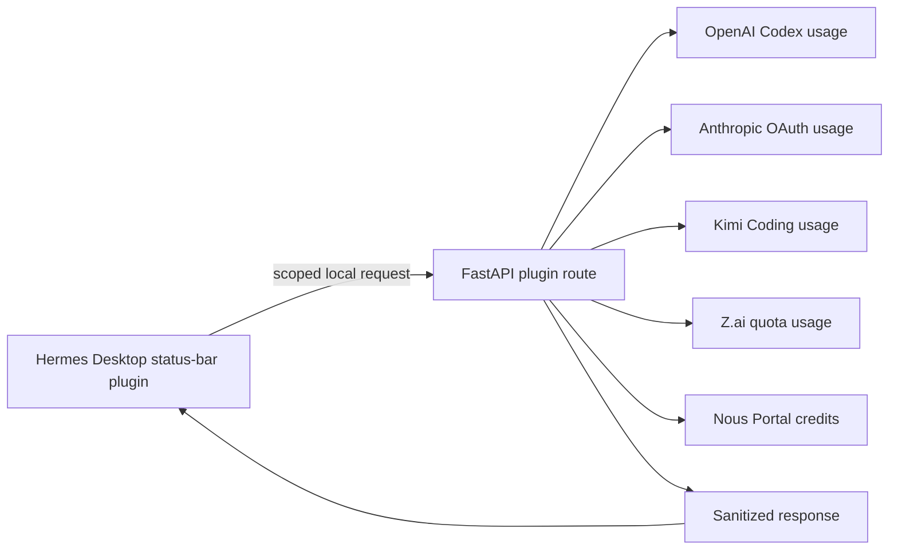

# Architecture

## Components



## Desktop frontend

`desktop/plugin.js` is a build-free Hermes Desktop plugin. It:

- Reads the focused session and runtime model from Hermes SDK state/events.
- Maps the runtime to a supported usage provider.
- Calls only its scoped backend through `ctx.rest('/usage')`.
- Stores a sanitized last-good payload in plugin-local storage.
- Keeps manual status-bar selection in plugin-local storage.
- Merges a temporarily unavailable provider with its last valid card and marks it stale.

## Python backend

`dashboard/plugin_api.py` mounts `/api/plugins/usage-dashboard/usage`. It:

- Resolves credentials through Hermes provider helpers.
- Queries providers concurrently with bounded HTTP timeouts.
- Normalizes percentages and reset times.
- Returns a fixed, sanitized card schema.
- Uses a process cache and collection lock to avoid request storms.
- Uses a sanitized shared Claude cache to tolerate temporary rate limiting across profiles.

## Sanitized response contract

```json
{
  "fetched_at": "ISO-8601 timestamp",
  "providers": [
    {
      "provider": "provider-id",
      "label": "Display name",
      "available": true,
      "plan": "Optional plan label",
      "source": "sanitized source name",
      "fetched_at": "ISO-8601 timestamp",
      "stale": false,
      "windows": [
        {
          "label": "Window label",
          "used_percent": 25.0,
          "remaining_percent": 75.0,
          "reset_at": "ISO-8601 timestamp or null",
          "detail": "Optional sanitized detail"
        }
      ],
      "details": [],
      "reason": null
    }
  ],
  "summary": {
    "available": 1,
    "total": 5,
    "lowest_remaining_percent": 75.0
  },
  "privacy": "Credentials remain in the local backend."
}
```

The contract excludes tokens, headers, raw responses, email addresses, account identifiers, and OAuth claims.

## Caching

- Backend response cache: 120 seconds.
- Frontend polling: 60 seconds, served by backend cache when fresh.
- Frontend last-good cache: 24 hours.
- Claude cross-profile fresh cache: 5 minutes.
- Claude stale fallback: up to 24 hours.

## Trust boundary

The frontend is treated as an untrusted display surface. Credential resolution and provider HTTP requests remain in the local backend. Errors returned to the UI are static or include only HTTP status codes.
